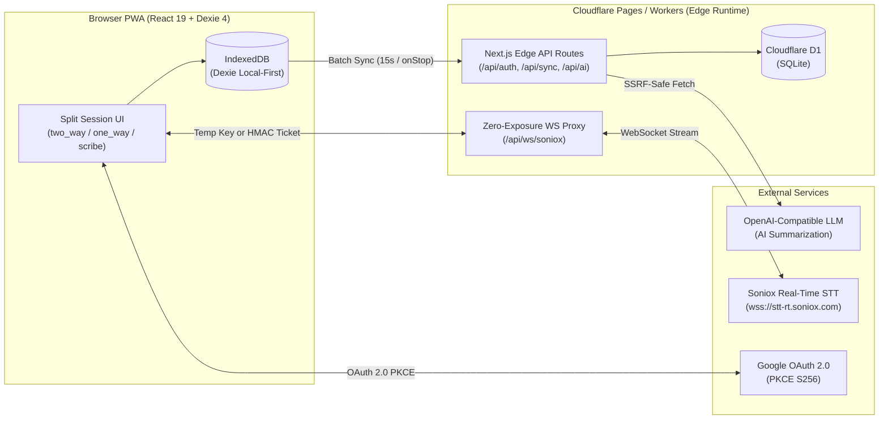

<div align="center">

# PayLingo v2

**Real-Time Two-Way Bilingual Speech-to-Text & AI Meeting Interpreter PWA**  
**Ứng Dụng PWA Phiên Dịch Hội Thoại Song Ngữ Thời Gian Thực & Tóm Tắt Họp AI**

[](https://nextjs.org/)
[](https://react.dev/)
[](https://www.typescriptlang.org/)
[](https://pages.cloudflare.com/)
[](https://developers.cloudflare.com/d1/)
[](https://soniox.com/)
[](./LICENSE)

[**English**](#-english-documentation) · [**Tiếng Việt**](#-tài-liệu-tiếng-việt)

</div>

---

# 🌐 English Documentation

## 1. Overview

**PayLingo v2** is an offline-resilient, local-first Progressive Web App (PWA) designed for real-time two-way bilingual interpretation between a **Vietnamese Host** (`vi`) and an **International Partner** (60+ supported languages + Auto Detect). Built for low-latency edge execution on **Cloudflare Pages / Workers** and **Cloudflare D1**, PayLingo combines real-time streaming transcription, speaker diarization, local IndexedDB persistence, AI meeting summarization, and password-protected report sharing.

---

## 2. Key Features

- **Real-Time Bilingual Interpretation (`stt-rt-v6`)**
  - Powered by `@soniox/react` WebSocket streaming with sub-second latency across **60+ languages** plus `Auto Detect` (`src/lib/languages.ts`).
  - **Three Session Modes** (`src/app/session/page.tsx`):
    - **Two-Way (`two_way`)**: Simultaneous bidirectional translation between Host (Vietnamese) and Partner.
    - **One-Way (`one_way`)**: Continuous translation from Partner's language into Vietnamese.
    - **Scribe (`scribe`)**: Real-time multi-speaker transcription without translation.
  - **Smart Transcript Parser (`src/lib/soniox-parser.ts`)**: Sentence boundary stitching, speaker diarization (`Speaker 1`, `Speaker 2`, ...), automatic filler-word stripping (`uh`, `um`, `ờ`, `ừm`...), and deterministic UUID generation.
- **Zero-Exposure Soniox WebSocket Security**
  - Issues 60-second single-use temporary keys via `POST /api/auth/soniox-key`.
  - Automatically falls back to an injected **Zero-Exposure Edge WebSocket Proxy** (`/api/ws/soniox` via `scripts/inject-ws-proxy.mjs`) authenticated with 60-second `HMAC-SHA256` tickets (`paylingo_ws_v1`) so the master `SONIOX_API_KEY` is never exposed to the client.
- **Local-First Architecture & Batch Cloud Sync**
  - Every folder, session, and transcript update writes immediately to **IndexedDB (Dexie 4)** (`src/lib/db.ts`) with `sync_status: 'pending'`.
  - Background synchronization (`src/lib/sync-manager.ts`) uploads pending records to **Cloudflare D1** (`POST /api/sync`) every 15 seconds when online, upon network reconnection, or on session stop (up to 100 folders/sessions and 500 transcript entries per request, executed in 50-statement D1 batches).
- **AI Meeting Summarization & Export**
  - Generates structured session or folder-wide summaries (`standard` & `executive` styles) via `POST /api/ai/summarize`.
  - **Export & Share Formats**: Export transcripts and summaries as **TXT (`.txt`)**, **JSON (`.json`)**, **Markdown (`.md`)**, standalone interactive **HTML** reports (`src/lib/html-generator.ts`) with strict XSS escaping, A4 print utilities (`src/lib/pdf-generator.ts`), or public share links (`/shared/[id]`) protected by optional **PBKDF2-SHA256** (100,000 iterations) passwords (`src/lib/shared-password.ts`).
- **Dual Authentication & Enterprise Security**
  - **User Auth**: **Google OAuth 2.0 SSO with PKCE (`S256`)** (`/api/auth/google`) and Access Code redemption (`/api/auth/redeem-code`), backed by `HttpOnly` session cookies (`paylingo_auth_session`) and D1 `auth_sessions`.
  - **Admin Console (`/kulam`)**: Independent admin authentication (`src/lib/admin-auth.ts`) with `PBKDF2-SHA256` password hashing, `HMAC-SHA256` session cookies (`admin_session`), and **WebAuthn Passkey (ECDSA P-256)** support. Configure encrypted AI/Soniox/Google OAuth keys (`AES-GCM-256` in D1 `api_settings`) and inspect usage logs.
  - **Zero Audio Retention**: Voice audio streams exclusively for live transcription and is never recorded or stored.
  - **SSRF & Rate-Limit Protection**: AI endpoints are validated against `AI_ALLOWED_HOSTS` and private IP blocklists (`src/lib/ai-security.ts`). Sensitive APIs enforce both in-memory sliding-window limits (`src/lib/rate-limit.ts`) and atomic D1 rate reservations (`ai_rate_limits`).
- **Multi-Language UI & Responsive Split Workspace**
  - Full UI localization in **Vietnamese (`vi`)**, **English (`en`)**, and **Chinese (`zh`)** (`src/lib/i18n.ts`) with automated 100% key parity verification.
  - Drag-to-resize split panels for Host and Partner views, supporting **Light** and **Dark** themes (`src/app/globals.css`).

---

## 3. Tech Stack & Architecture

| Layer | Technology |
| :--- | :--- |
| **Framework** | Next.js 16.2 (App Router), React 19.2, TypeScript 5 |
| **Styling & UI** | Tailwind CSS v4, `@shadcn/lint` Design System, Lucide Icons |
| **Runtime & Hosting** | Cloudflare Pages / Workers (`export const runtime = 'edge'`, `@cloudflare/next-on-pages`) |
| **Cloud Database** | Cloudflare D1 (SQLite) via `src/lib/d1-client.ts` (auto-fallback to local `.data/paylingo_d1.sqlite` in Node dev/test) |
| **Client Local DB** | Dexie 4 (IndexedDB) (`src/lib/db.ts`) |
| **Real-Time STT** | Soniox WebSocket (`@soniox/react` v2.3, model `stt-rt-v6`) + Edge WebSocket Proxy |
| **Cryptography** | Web Crypto API (`crypto.subtle` — `AES-GCM-256`, `PBKDF2-SHA256`, `HMAC-SHA256`, `ECDSA P-256`) |
| **Mobile Companion** | Kotlin Multiplatform (Android & iOS) in `paylingo-mobile/` |



---

## 4. Directory Structure

```text
├── migrations/                  # Incremental Cloudflare D1 SQL migrations
├── paylingo-mobile/             # Standalone Kotlin Multiplatform (Android/iOS) mobile app
├── public/                      # PWA manifest, service worker, icons, and static assets
├── scripts/
│   └── inject-ws-proxy.mjs      # Injects Zero-Exposure Soniox WebSocket proxy into _worker.js
├── src/
│   ├── app/
│   │   ├── api/                 # Edge API routes (auth, admin, ai, history, shared, sync)
│   │   ├── history/             # Session & folder archive workspace
│   │   ├── kulam/               # Admin dashboard & WebAuthn Passkey management
│   │   ├── session/             # Live bilingual interpretation workspace
│   │   └── shared/              # Password-protected shared summary viewer
│   ├── components/              # Reusable UI components (@shadcn/lint compliant)
│   ├── hooks/                   # Theme and state hooks (useTheme)
│   └── lib/
│       ├── auth/                # Session management, Google OAuth PKCE, SMTP helpers
│       ├── admin-auth.ts        # Admin PBKDF2, HMAC session & WebAuthn Passkey verification
│       ├── ai-security.ts       # SSRF validation, AES-GCM-256 key encryption, WS ticket minting
│       ├── d1-client.ts         # Cloudflare D1 binding + local SQLite fallback
│       ├── db.ts                # Dexie 4 IndexedDB schema
│       ├── html-generator.ts    # Escaped standalone HTML report generator
│       ├── i18n.ts              # Tri-lingual UI dictionary (vi, en, zh)
│       ├── languages.ts         # 60+ Soniox languages + CLDR flag mappings
│       ├── pdf-generator.ts     # Native A4 print-to-PDF generator
│       ├── soniox-parser.ts     # Token stitching, speaker diarization & filler removal
│       └── sync-manager.ts      # Local-first to D1 batch synchronization engine
├── supabase/
│   └── d1-schema.sql            # Canonical Cloudflare D1 SQLite schema
├── tests/                       # Node test runner unit & security regression suite
└── wrangler.toml                # Cloudflare Pages & D1 configuration
```

---

## 5. Getting Started

### Prerequisites
- **Node.js** `>= 20.x` (supports native `--experimental-strip-types` and `node:sqlite` for local D1 fallback)
- **npm** `>= 10.x`
- **Cloudflare Wrangler CLI** (optional, for D1 cloud migrations and Pages deployment)

### 1. Install Dependencies

```bash
npm install
```

### 2. Configure Environment Variables

Copy `.env.example` to `.env.local` and fill in the required secrets:

```bash
cp .env.example .env.local
```

| Variable | Required | Description |
| :--- | :---: | :--- |
| `SONIOX_API_KEY` | Yes* | Master Soniox API key for real-time speech recognition (*can also be configured in Admin UI). |
| `GOOGLE_CLIENT_ID` | Yes* | Google OAuth 2.0 Client ID for user SSO (*or configure in Admin UI). |
| `GOOGLE_CLIENT_SECRET` | Yes* | Google OAuth 2.0 Client Secret (*or configure in Admin UI). |
| `ADMIN_SESSION_SECRET` | **Yes** | Secret key (`>= 32` characters) used to sign `admin_session` HMAC cookies. |
| `AI_KEY_ENCRYPTION_SECRET` | **Yes** | Secret key (`>= 32` characters) for `AES-GCM-256` encryption of API keys stored in D1. |
| `ADMIN_BOOTSTRAP_PASSWORD` | Optional | Initial password to bootstrap `/kulam` admin login before setting a custom password/Passkey in D1. |
| `NEXT_PUBLIC_APP_URL` | **Yes** | Canonical public URL of the deployment (e.g., `https://noidi.9phut.org`). |
| `PASSKEY_RP_ID` | **Yes** | WebAuthn Relying Party domain (e.g., `noidi.9phut.org` or `localhost`). |
| `PASSKEY_ORIGIN` | **Yes** | Expected WebAuthn origin URL (e.g., `https://noidi.9phut.org` or `http://localhost:3000`). |
| `AI_ALLOWED_HOSTS` | **Yes** | Comma-separated allowlist of AI provider hostnames (e.g., `api.openai.com,9r.9phut.org`). |

### 3. Run Local Development Server

When running locally in Node.js, `getD1()` (`src/lib/d1-client.ts`) automatically initializes a local SQLite database at `.data/paylingo_d1.sqlite` using `supabase/d1-schema.sql`.

```bash
npm run dev
```

Open [http://localhost:3000](http://localhost:3000) in your browser.

---

## 6. Testing, Linting & Deployment

### Quality Verification Commands

```bash
# 1. Run ESLint & @shadcn/lint design system checks
npm run lint

# 2. Run Unit & Security Regression Tests (Node native test runner)
npm test

# 3. Verify standard Next.js production build
npm run build
```

The automated test suite (`tests/*.test.mjs`) covers:
- `ai-security.test.mjs` — SSRF hostname allowlisting, private IP blocking & AES-GCM key encryption
- `auth-session-persistence.test.mjs` — Session lifecycle & cookie handling
- `d1-database.test.mjs` — Local D1 SQLite adapter & schema operations
- `html-generator.test.mjs` & `pdf-generator.test.mjs` — XSS sanitization in exported reports
- `i18n-parity.test.mjs` — 100% translation key parity across `vi`, `en`, and `zh`
- `security-regressions.test.mjs` — Ownership enforcement (`owner_id`), admin auth, and rate limiting
- `shared-password.test.mjs` — Salted PBKDF2-SHA256 shared link password hashing
- `soniox-key-security.test.mjs` — Temporary key & HMAC WebSocket ticket security
- `soniox-parser.test.mjs` — Real-time token assembly, speaker diarization & filler word filtering

### Deploying to Cloudflare Pages & D1

```bash
# Initialize or update remote Cloudflare D1 schema
npx wrangler d1 execute paylingo-database --remote --file=supabase/d1-schema.sql
npx wrangler d1 migrations apply paylingo-database --remote

# Build Edge bundle + inject Zero-Exposure Soniox WebSocket Proxy
npm run build:pages

# Deploy to Cloudflare Pages
npx wrangler pages deploy .vercel/output/static --project-name=paylingo
```

---
---

# 🇻🇳 Tài Liệu Tiếng Việt

## 1. Giới Thiệu Tổng Quan

**PayLingo v2** là ứng dụng Progressive Web App (PWA) dịch hội thoại song ngữ thời gian thực 2 chiều giữa **Chủ trì người Việt (`Host` — luôn là Tiếng Việt)** và **Đối tác quốc tế (`Partner` — hơn 60 ngôn ngữ + Tự động nhận diện)**. Được tối ưu hóa để chạy hoàn toàn trên **Cloudflare Pages / Workers (Edge Runtime)** kết hợp cơ sở dữ liệu **Cloudflare D1 (SQLite)** và lưu trữ cục bộ **IndexedDB (Dexie 4)**, PayLingo đảm bảo tốc độ phản hồi tức thì, hoạt động bền bỉ ngay cả khi mạng chập chờn và bảo mật tuyệt đối dữ liệu hội thoại.

---

## 2. Tính Năng Nổi Bật

- **Phiên Dịch Song Ngữ Thời Gian Thực (`stt-rt-v6`)**
  - Tích hợp `@soniox/react` truyền tải qua WebSocket với độ trễ cực thấp, hỗ trợ **hơn 60 ngôn ngữ** và chế độ `Tự động nhận diện` (`src/lib/languages.ts`).
  - **3 Chế Độ Phiên Làm Việc** (`src/app/session/page.tsx`):
    - **Song ngữ 2 chiều (`two_way`)**: Dịch tự động 2 chiều giữa Chủ trì (Tiếng Việt) và Đối tác nước ngoài.
    - **Dịch 1 chiều (`one_way`)**: Dịch liên tục từ ngôn ngữ của Đối tác sang Tiếng Việt.
    - **Chỉ ghi âm chữ (`scribe`)**: Chuyển giọng nói thành văn bản đa người nói (Speaker Diarization) không kèm dịch.
  - **Bộ Xử Lý Ngôn Ngữ Thông Minh (`src/lib/soniox-parser.ts`)**: Tự động ghép câu theo ngữ cảnh, phân tách người nói (`Speaker 1`, `Speaker 2`, ...), lọc bỏ từ đệm (`uh`, `um`, `ờ`, `ừm`, `à`...) và tạo định danh UUID nhất quán.
- **Bảo Mật Khóa Soniox & Zero-Exposure WebSocket Proxy**
  - Cấp khóa tạm thời (60 giây, dùng 1 lần) qua `POST /api/auth/soniox-key`.
  - Tự động chuyển sang **Edge WebSocket Proxy** (`/api/ws/soniox` được tiêm tự động qua `scripts/inject-ws-proxy.mjs`) xác thực bằng vé `HMAC-SHA256` 60 giây (`paylingo_ws_v1`) khi dùng khóa giới hạn quyền — đảm bảo khóa gốc `SONIOX_API_KEY` **không bao giờ** bị lộ xuống trình duyệt.
- **Kiến Trúc Local-First & Đồng Bộ Đám Mây Theo Lô (Batch Sync)**
  - Mọi thao tác tạo thư mục, phiên họp và câu hội thoại đều được ghi tức thì vào **IndexedDB (Dexie 4)** (`src/lib/db.ts`) với trạng thái `sync_status: 'pending'`.
  - Tiến trình đồng bộ ngầm (`src/lib/sync-manager.ts`) đẩy dữ liệu lên **Cloudflare D1** (`POST /api/sync`) định kỳ mỗi 15 giây khi có mạng, khi kết nối mạng phục hồi, hoặc ngay khi kết thúc phiên (tối đa 100 thư mục/phiên và 500 câu thoại mỗi lần, ghi theo từng cụm 50 lệnh bằng `db.batch()`).
- **Tóm Tắt Cuộc Họp Bằng AI & Xuất Báo Cáo**
  - Tạo bản tóm tắt nội dung thông minh cho từng phiên hoặc toàn bộ thư mục (`standard` & `executive`) qua `POST /api/ai/summarize`.
  - **Xuất & Chia Sẻ**: Xuất biên bản và tóm tắt dưới dạng **TXT (`.txt`)**, **JSON (`.json`)**, **Markdown (`.md`)**, báo cáo **HTML** tương tác độc lập (`src/lib/html-generator.ts`), tiện ích in trang A4 (`src/lib/pdf-generator.ts`) chống XSS toàn diện, hoặc tạo liên kết chia sẻ (`/shared/[id]`) có bảo vệ bằng mật khẩu băm **PBKDF2-SHA256** (100.000 vòng lặp).
- **Hệ Thống Xác Thực Kép & Bảo Mật Cấp Doanh Nghiệp**
  - **Xác thực người dùng**: Đăng nhập **Google OAuth 2.0 SSO kèm PKCE (`S256`)** (`/api/auth/google`) và mã truy cập (`/api/auth/redeem-code`), quản lý phiên qua cookie `HttpOnly` (`paylingo_auth_session`) trên D1. Hỗ trợ xóa toàn bộ tài khoản và dữ liệu cá nhân (`DELETE /api/auth/delete-account`).
  - **Trang Quản Trị (`/kulam`)**: Xác thực độc lập (`src/lib/admin-auth.ts`) bằng mật khẩu `PBKDF2-SHA256` + chữ ký `HMAC-SHA256` (`admin_session`) và khóa bảo mật phần cứng **WebAuthn Passkey (ECDSA P-256)**. Cho phép cấu hình khóa API (mã hóa `AES-GCM-256` trong bảng `api_settings`) và theo dõi nhật ký sử dụng.
  - **Không Lưu Trữ Âm Thanh (Zero Audio Retention)**: Luồng âm thanh chỉ dùng để nhận diện chữ theo thời gian thực, tuyệt đối không ghi hay lưu file audio lên máy chủ.
  - **Chống SSRF & Giới Hạn Tần Suất (Rate Limiting)**: Kiểm tra tên miền AI qua `getSafeAiEndpoint()` (`src/lib/ai-security.ts`) và chặn dải IP nội bộ. Kết hợp Rate Limit trên bộ nhớ (`src/lib/rate-limit.ts`) và đặt chỗ nguyên tử trên D1 (`ai_rate_limits`).
- **Đa Ngôn Ngữ (i18n) & Giao Diện Chia Đôi Linh Hoạt**
  - Hỗ trợ 3 ngôn ngữ giao diện: **Tiếng Việt (`vi` — mặc định)**, **Tiếng Anh (`en`)**, và **Tiếng Trung (`zh`)** (`src/lib/i18n.ts`), được kiểm tra đối xứng key 100% tự động.
  - Bố cục chia đôi màn hình cho phép kéo thả thay đổi kích thước giữa khung Chủ trì và Đối tác, hỗ trợ 2 giao diện **Sáng (Light)** và **Tối (Dark)**.

---

## 3. Cài Đặt & Phát Triển Cục Bộ

### Yêu Cầu Hệ Thống
- **Node.js** `>= 20.x` (hỗ trợ chạy trực tiếp TypeScript trong test và `node:sqlite` cho D1 cục bộ)
- **npm** `>= 10.x`

### Các Bước Khởi Chạy

```bash
# 1. Cài đặt thư viện
npm install

# 2. Tạo file cấu hình môi trường
cp .env.example .env.local
```

Cập nhật các biến môi trường trong `.env.local` (xem bảng giải thích chi tiết ở phần tiếng Anh phía trên), sau đó khởi chạy server phát triển:

```bash
# 3. Chạy môi trường dev (tự động tạo SQLite cục bộ tại .data/paylingo_d1.sqlite)
npm run dev
```

Truy cập ứng dụng tại [http://localhost:3000](http://localhost:3000) và trang quản trị tại [http://localhost:3000/kulam](http://localhost:3000/kulam).

---

## 4. Kiểm Thử & Triển Khai (Cloudflare Pages)

Trước khi hoàn tất thay đổi hoặc triển khai, luôn chạy đầy đủ 3 bước kiểm tra chất lượng:

```bash
# Kiểm tra quy tắc code & hệ thống thiết kế (@shadcn/lint)
npm run lint

# Chạy toàn bộ Unit Test & Kiểm thử bảo mật (10 bộ test)
npm test

# Kiểm tra build Next.js
npm run build
```

Để đóng gói Edge Worker (kèm tiêm tự động WebSocket Proxy `/api/ws/soniox`) và triển khai lên **Cloudflare Pages**:

```bash
npm run build:pages
npx wrangler pages deploy .vercel/output/static --project-name=paylingo
```

---

## 📄 License / Giấy Phép

Copyright © 2026 **JstKuLam (PayLingo / Pay2Pay)**.

This repository is distributed under a **Dual-License Model** (see [LICENSE](./LICENSE)):

1. **[PolyForm Noncommercial License 1.0.0](https://polyformproject.org/licenses/noncommercial/1.0.0)** (`PolyForm-Noncommercial-1.0.0`)
   - **English**: Free for personal study, research, educational, and non-commercial use. Any commercial use, paid SaaS redistribution, or production deployment by a for-profit organization is strictly prohibited without prior written permission from the copyright holder.
   - **Tiếng Việt**: Cho phép sử dụng miễn phí cho mục đích cá nhân, học tập, nghiên cứu và phi thương mại. **Nghiêm cấm** mọi hành vi sử dụng thương mại, kinh doanh dịch vụ (SaaS) hoặc triển khai trong doanh nghiệp vì mục đích lợi nhuận nếu chưa có sự đồng ý bằng văn bản của tác giả.
2. **[GNU Affero General Public License v3.0 (AGPL-3.0)](https://www.gnu.org/licenses/agpl-3.0.html)** (`AGPL-3.0-only`)
   - **English**: Any permitted derivative work, modification, or network/web service deployment interacting with users over a network must disclose the complete corresponding source code under the same AGPL-3.0 terms and retain all original copyright notices.
   - **Tiếng Việt**: Mọi bản chỉnh sửa, phái sinh hoặc triển khai chạy dưới dạng dịch vụ mạng/web (cho người dùng tương tác qua mạng) đều **bắt buộc phải công khai toàn bộ mã nguồn tương ứng** theo đúng điều khoản AGPL-3.0 và giữ nguyên thông tin bản quyền gốc.

